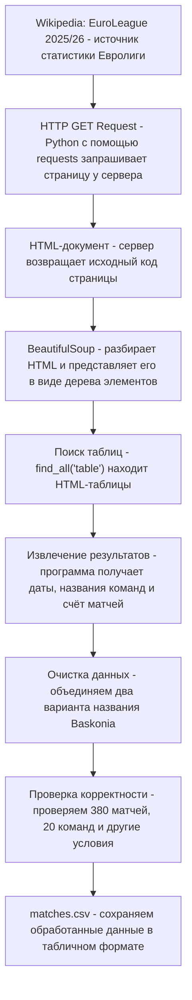
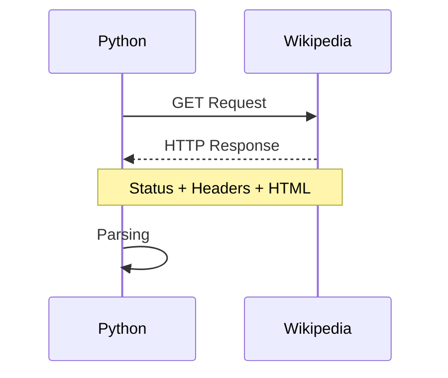
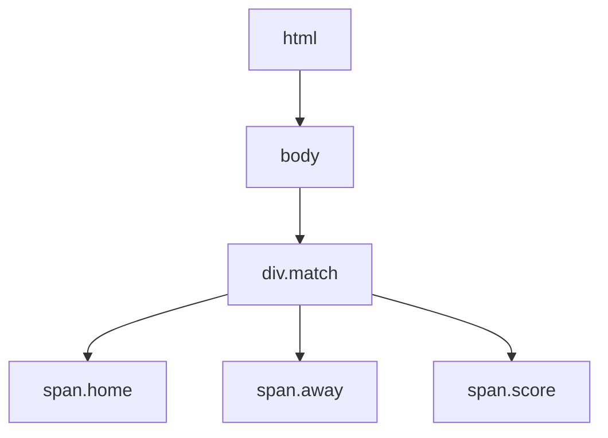
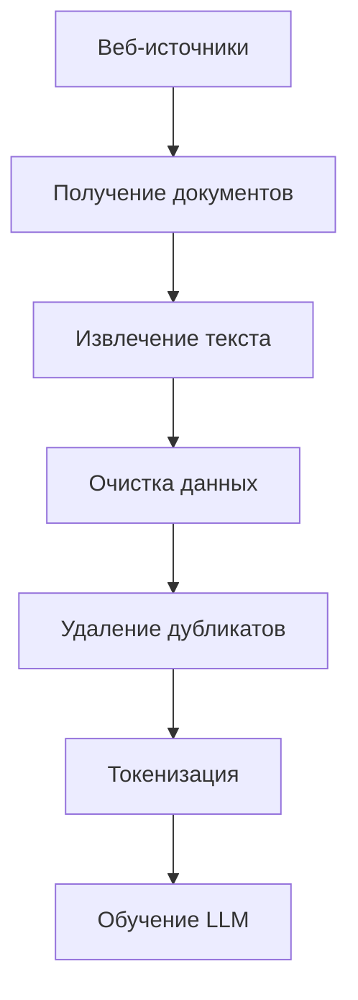
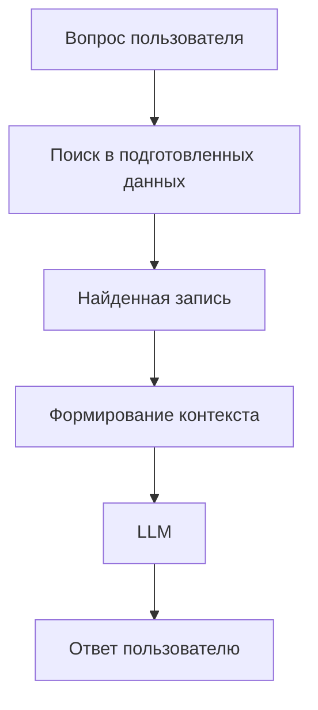

# Web Scraping на Python

### Парсинг данных из открытых источников на примере Евролиги 2025/26

**Python · Requests · BeautifulSoup · HTML · Regular Expressions · CSV**

---

## 1. Введение

### Что такое Web Scraping?

**Web Scraping** — технология автоматизированного извлечения информации с веб-страниц.

Предположим, нам нужно собрать результаты нескольких сотен матчей. Можно вручную открывать страницы, копировать названия команд, даты и счёт в таблицу.

Но это займёт много времени, а вероятность ошибок при ручном переносе данных будет увеличиваться.

С помощью Python этот процесс можно автоматизировать.

В этом докладе я разберу:

- Как устроен Web Scraping.
- Как Python взаимодействует с веб-серверами.
- Как устроены HTML-документы.
- Как работают HTML-парсеры.
- Какие алгоритмы и математические принципы используются.
- Какие ошибки могут возникать при сборе данных.
- Как парсинг применяется при работе с LLM.

Для практической демонстрации я написал Python-парсер, который собирает результаты матчей баскетбольной Евролиги сезона 2025/26.

### Почему именно Евролига?

В регулярном чемпионате участвовало 20 команд, каждая из которых провела 38 матчей.

Всего состоялось 380 матчей.

| Показатель | Значение |
|---|---:|
| Сезон | 2025/26 |
| Команды | 20 |
| Туры | 38 |
| Матчи | 380 |
| Источник | Wikipedia |
| Язык | Python |
| Результат | CSV |

**Цель практической части:** автоматически извлечь результаты всех 380 матчей, привести их к единому формату, проверить и сохранить для дальнейшего анализа.

### Web Scraping, Parsing и Crawling

Эти понятия связаны между собой, но обозначают разные процессы.

| Термин | Значение |
|---|---|
| **Web Scraping** | Автоматизированное извлечение информации с сайтов (собираем данные)|
| **Parsing** | Разбор структуры документа по определённым правилам |
| **Web Crawling** | Автоматический обход веб-страниц и переход по ссылкам |
| **API** | Интерфейс программного взаимодействия с сервисом |

Например, скачивание HTML-кода страницы ещё не означает, что мы выполнили полноценный парсинг.

Сначала необходимо разобраться в структуре документа и извлечь конкретные данные.

В практической части используется **HTML-парсинг**, а не загрузка готового CSV через API.
Использовался Web Scraping, внутри которого выполнялся Parsing с помощью BeautifulSoup.
---

## 2. Как работает Web Scraping?

Процесс веб-парсинга можно разделить на несколько этапов:

1. Отправка запроса к серверу.
2. Получение HTML-документа.
3. Анализ структуры HTML.
4. Поиск необходимых элементов.
5. Извлечение информации.
6. Очистка и проверка данных.
7. Сохранение результата.

### Схема работы парсера



В докладе Python получает страницу Wikipedia, находит таблицы с результатами матчей, извлекает из них информацию и сохраняет её в CSV-файл.

Главная задача — преобразовать данные из HTML-документа в структурированный набор записей, пригодный для дальнейшей обработки.

---

## 3. HTTP и HTTPS

### Клиент-серверная архитектура

Работа большинства сайтов основана на взаимодействии клиента и сервера.

**Клиент** — программа, отправляющая запрос.

**Сервер** — система, принимающая запрос и возвращающая ответ.

В практической части клиентом является Python-программа, а сервером — инфраструктура Wikipedia.

### HTTP

**HTTP (Hypertext Transfer Protocol)** — протокол прикладного уровня, определяющий правила обмена HTTP-сообщениями.

HTTP-запрос содержит:

- Метод запроса.
- Адрес ресурса.
- Заголовки.
- При необходимости — тело запроса.

Наиболее известные методы:

| Метод | Назначение |
|---|---|
| GET | Получение представления ресурса |
| POST | Передача данных для обработки сервером |
| PUT | Создание или замена представления ресурса |
| DELETE | Запрос на удаление ресурса |

Для получения HTML-страницы используется **GET**.

### HTTPS

**HTTPS** — использование HTTP поверх защищённого TLS-соединения.

TLS обеспечивает:

- Шифрование передаваемых данных.
- Проверку целостности передачи.
- Аутентификацию сервера с помощью сертификата.

Однако HTTPS не гарантирует достоверность содержимого веб-страницы.

### HTTP Request и HTTP Response



HTTP-ответ состоит из трёх основных частей:

1. **Status Code** — результат обработки запроса.
2. **Headers** — (заголовки) метаданные ответа.
3. **Body** — HTML, тело ответа (сами данные).

### Основные HTTP-коды

| Код | Значение |
|---|---|
| 200 | Запрос успешно обработан |
| 301 | Постоянное перенаправление |
| 403 | Доступ запрещён |
| 404 | Ресурс не найден |
| 429 | Слишком много запросов |
| 500 | Внутренняя ошибка сервера |

### Реализация на Python

Для получения страницы я использовал библиотеку `requests`.

```python
import requests

url = "https://en.wikipedia.org/wiki/2025%E2%80%9326_EuroLeague_regular_season"
headers = {
    "User-Agent": "EuroLeagueStudy/0.1 (https://github.com/m3t4morph0sis)"
}
response = requests.get(
    url,
    headers=headers,
    timeout=15
)
response.raise_for_status()
```

Что происходит:

- `requests.get()` отправляет GET-запрос.
- `url` содержит адрес страницы.
- `headers` задаёт HTTP-заголовки.
- `User-Agent` идентифицирует программу.
- `timeout` ограничивает время ожидания сетевых операций.
- `raise_for_status()` вызывает исключение при HTTP-ошибке, например 403 или 404.

### Результат

После успешного запроса сервер возвращает:

`HTTP 200 OK`

Тип содержимого:

`text/html; charset=UTF-8`

Это означает, что Python получил HTML-документ.

**Но успешное получение HTML ещё не гарантирует успешное извлечение данных.**

---

## 4. HTML и DOM

### Что такое HTML?

**HTML (HyperText Markup Language)** — язык разметки, описывающий структуру веб-документа.

HTML состоит из элементов, которые могут содержать:

- Текст.
- Атрибуты.
- Другие вложенные элементы.

Например:

```html
<div class="match">
    <span class="home">Olympiacos</span>
    <span class="away">Real Madrid</span>
    <span class="score">90:85</span>
</div>
```

*Это условный пример, а не точная HTML*

Здесь:

- `<div>` — контейнер.
- `<span>` — элемент для текстового содержимого.
- `class` — атрибут.
- `home`, `away`, `score` — значения классов.

### Что такое DOM?

**DOM (Document Object Model)** — объектная модель документа, представляющая его структуру в виде дерева узлов.

У каждого узла могут быть:

- Родительский узел.
- Дочерние узлы.
- Соседние узлы.

### Представление HTML в виде дерева



`div.match` — родительский элемент для трёх `span`.

### Почему это важно?

HTML — не просто набор строк.

Документ содержит иерархическую структуру, которую необходимо учитывать при поиске информации.

Например, название команды может находиться внутри определённой ячейки таблицы, а счёт — внутри соседней.

Поэтому искать нужные элементы по структуре часто надёжнее, чем искать отдельные слова по всему документу.

**BeautifulSoup строит собственное дерево объектов HTML. Оно похоже на DOM по принципу организации, но не является браузерным DOM.**

---

## 5. BeautifulSoup

### Что это такое?

**BeautifulSoup** — Python-библиотека для разбора HTML и XML.

Она позволяет искать элементы документа по тегам, атрибутам, классам и CSS-селекторам.

В моей реализации используется встроенный в Python парсер `html.parser`.

### Создание объекта BeautifulSoup

```python
from bs4 import BeautifulSoup

soup = BeautifulSoup(response.text, "html.parser")
```

Здесь:

- `response.text` — HTML в виде строки.
- `html.parser` — механизм разбора HTML.
- `soup` — объект для поиска элементов в разобранном документе.

### Основные методы

| Метод | Что делает |
|---|---|
| `find()` | Возвращает первый подходящий элемент |
| `find_all()` | Возвращает все подходящие элементы |
| `select_one()` | Ищет первый элемент по CSS-селектору |
| `get_text()` | Извлекает текст |
| `get()` | Получает значение атрибута |
| `prettify()` | Форматирует HTML с отступами |

### Поиск таблиц

```python
tables = soup.find_all("table")
```

С помощью `find_all()` я получил все HTML-таблицы страницы.

Результат запуска:

**394 HTML-таблицы.**

Однако это не означает, что на странице 394 матча.

Часть таблиц содержит вспомогательные сведения, турнирную статистику и другую информацию.

Поэтому следующий этап — найти именно таблицы с результатами матчей.

---

## 6. Практическая реализация парсера

### Что нужно извлечь?

Для каждого матча необходимы пять значений:

| Поле | Что означает |
|---|---|
| `date` | Дата матча |
| `home_team` | Команда-хозяйка |
| `away_team` | Гостевая команда |
| `home_points` | Очки хозяев |
| `away_points` | Очки гостей |

### Структура HTML-таблицы

При исследовании разметки Wikipedia я обнаружил, что данные матча находятся в ячейках строки таблицы.

| Ячейка | Информация |
|---|---|
| `td[0]` | Дата |
| `td[1]` | Хозяева |
| `td[2]` | Счёт |
| `td[3]` | Гости |

Это относится к используемой структуре HTML-страницы. При изменении разметки сайта алгоритм может потребовать доработки.

### Этап 1. Поиск подходящих таблиц

```python
for table in tables:
    row = table.find("tr")

    if row is None:
        continue

    cells = row.find_all("td", recursive=False)

    if len(cells) < 4:
        continue
```

Здесь программа перебирает таблицы и анализирует их структуру.

`continue` означает переход к следующей итерации цикла.

Если таблица не соответствует ожидаемому формату, программа пропускает её.

`recursive=False` ограничивает поиск непосредственными дочерними элементами.
 
tr - Table Row -строка таблицы

td - Table Data - ячейка внутри строки

table - сама таблица

<html>
    <body>
        <table>
            <tr>
                <td>Real Madrid</td>
                <td>85:80</td>
            </tr>
        </table>
    </body>
</html>

!ПОКАЗАТЬ ПРИМЕР КОДА!

### Этап 2. Извлечение команд

```python
home = cells[1].select_one(".fn.org")
away = cells[3].select_one(".fn.org")

if home is None or away is None:
    continue
```

CSS-селектор `.fn.org` ищет HTML-элемент, имеющий одновременно классы `fn` и `org`.

Если элемент команды отсутствует, таблица пропускается.

### Этап 3. Извлечение счёта

Например, на странице счёт представлен строкой:

`103 – 87`

Но для дальнейшего анализа нужны два отдельных целых числа.

Для решения этой задачи я использовал регулярное выражение:

```python
score = cells[2].get_text(" ", strip=True)

result = re.search(
    r"(\d+)\s*[-–—−]\s*(\d+)",
    score
)

if result is None:
    continue
```

### Что такое регулярное выражение?

**Regular Expression (RegEx)** — шаблон для поиска и обработки текстовых данных.

Разберём использованный шаблон:

`r"(\d+)\s*[-–—−]\s*(\d+)"`

| Часть | Значение |
|---|---|
| `\d+` | Одна или более цифр |
| `\s*` | Ноль или более пробельных символов |
| `[-–—−]` | Допустимые виды тире |
| `(...)` | Группа захвата |

Например:

`103 – 87`

Программа выделяет:

- Первое число: `103`
- Второе число: `87`

```python
home_points = int(result.group(1))
away_points = int(result.group(2))
```

Метод `group()` получает содержимое соответствующей группы регулярного выражения.

`int()` преобразует строку в целое число.

### Этап 4. Формирование записи

Для каждого матча создаётся словарь:

```python
match = {
    "date": cells[0].get_text(" ", strip=True),
    "home_team": home.get_text(" ", strip=True),
    "away_team": away.get_text(" ", strip=True),
    "home_points": int(result.group(1)),
    "away_points": int(result.group(2))
}
```

Словарь хранит данные в формате:

`ключ → значение`

Все полученные записи добавляются в список `matches`.

### Результат

Парсер извлёк **380 матчей регулярного чемпионата Евролиги 2025/26**.

---

## 7. Математическая основа

### 7.1. HTML как дерево

HTML-документ можно рассматривать как дерево — частный случай графа.

Математически граф записывается:

$$
G=(V,E)
$$

где:

- $V$ — множество вершин.
- $E$ — множество рёбер.

Для HTML-дерева вершинами выступают узлы, а рёбрами — связи между родительскими и дочерними узлами.

В дереве из $N$ вершин:

$$
|E|=N-1
$$

Это свойство следует из того, что каждый узел, кроме корневого, имеет ровно одного родителя.

### 7.2. Обход дерева

Для поиска элементов в древовидных структурах используются алгоритмы обхода.

Два известных подхода:

- **DFS (Depth-First Search)** — обход в глубину.
- **BFS (Breadth-First Search)** — обход в ширину.

DFS сначала исследует более глубокие узлы, а BFS — узлы по уровням.

Эти алгоритмы важны для понимания способов работы с деревьями.

BeautifulSoup предоставляет готовые методы поиска, поэтому вручную реализовывать DFS или BFS для нашего парсера не потребовалось.

### 7.3. Асимптотическая сложность

Асимптотическая сложность описывает, как увеличивается стоимость выполнения алгоритма с ростом входных данных.

| Сложность | Пример |
|---|---|
| $O(1)$ | Доступ к элементу списка по индексу |
| $O(n)$ | Один проход по списку |
| $O(n^2)$ | Два вложенных цикла по $n$ элементам |

В нашем случае есть цикл:

```python
for table in tables:
    ...
```

Пусть $T$ — количество HTML-таблиц.

Если обработка каждой таблицы занимала бы ограниченное постоянное время, стоимость цикла составляла бы:

$$
O(T)
$$

Однако фактическая обработка таблицы включает поиск элементов, который тоже требует времени.

Обозначим:

- $N$ — размер HTML-документа;
- $T$ — число таблиц;
- $c_i$ — стоимость обработки $i$-й таблицы.

Тогда для упрощённой модели, в которой стоимость построения дерева линейна по размеру документа:

$$
T_{\text{total}}=O\left(N+\sum_{i=1}^{T}c_i\right)
$$

Эта формула показывает, что сложность зависит не только от числа таблиц, но и от размера документа и структуры вложенных элементов.

**Важно:** это теоретическая модель. Конкретное время работы зависит также от реализации библиотек, компьютера и скорости сети.

### 7.4. Комбинаторика и количество матчей

В Евролиге участвует $n=20$ команд.

Каждая пара команд проводит два матча: дома и в гостях.

Количество неупорядоченных пар:

$$
C_n^2=\frac{n(n-1)}{2}
$$

Поскольку каждая пара играет дважды:

$$
M=2C_n^2=n(n-1)
$$

При $n=20$:

$$
M=20\cdot19=\boxed{380}
$$

Это число используется для проверки результата парсинга.

---

## 8. Проверка качества данных

После извлечения информации необходимо убедиться, что полученный набор данных соответствует структуре чемпионата.

Реализованы следующие проверки:

| Проверка | Ожидаемое значение |
|---|---|
| Количество матчей | 380 |
| Количество команд | 20 |
| Матчей у каждой команды | 38 |
| Повторы упорядоченных пар хозяева–гости | Нет |

### Использование set()

`set()` — структура данных, хранящая уникальные элементы.

В моей программе она используется для подсчёта уникальных названий команд.

```python
teams = set()

for match in matches:
    teams.add(match["home_team"])
    teams.add(match["away_team"])
```

### Использование Counter()

`Counter` — класс из стандартного модуля `collections`, предназначенный для подсчёта количества вхождений элементов.

```python
from collections import Counter

games_count = Counter()

for match in matches:
    games_count[match["home_team"]] += 1
    games_count[match["away_team"]] += 1
```

Таким образом можно определить количество матчей каждой команды.

### Проверка всех условий

```python
is_valid = (
    len(matches) == 380
    and len(teams) == 20
    and all(count == 38 for count in games_count.values())
    and len(match_pairs) == len(set(match_pairs))
)
```

Оператор `and` требует одновременного выполнения всех условий.

### Математическая проверка

Каждая из 20 команд должна провести 38 матчей:

$$
20\cdot38=760
$$

Но в каждом матче участвуют две команды, поэтому:

$$
M=\frac{760}{2}=\boxed{380}
$$

Это дополнительная проверка согласованности структуры турнира.

### Ограничения

Количество найденных матчей само по себе не гарантирует правильность всех значений.

Например, программа могла ошибочно извлечь счёт одного матча, но количество записей осталось бы прежним.

Для более строгой проверки можно дополнительно:

- Проверять допустимость числовых значений.
- Проверять корректность дат.
- Исключать матчи команды с самой собой.
- Сверять результаты с независимыми источниками.

**Текущая реализация подтверждает структурную согласованность датасета, но не гарантирует абсолютную точность каждого счёта.**

---

## 9. Проблемы, возникшие при парсинге

В ходе разработки парсера возникли несколько проблем, связанных с получением HTML, качеством извлечённых данных и особенностями работы с большими документами.

Их разбор показывает, почему Web Scraping включает не только извлечение информации, но и диагностику ошибок, очистку данных и проверку результата.

### 9.1. Ошибка HTTP 403 Forbidden

#### Проблема

Первоначально HTTP-запрос к Wikipedia отправлялся без специально настроенного заголовка `User-Agent`.

```python
response = requests.get(url, timeout=15)
print(response.status_code)
```

**Результат:**

```text
403
```

Код состояния `403 Forbidden` означает, что сервер отказался предоставлять запрошенный ресурс.

При этом ошибка не обязательно означает, что страница отсутствует. Сервер может отклонять запросы в зависимости от настроек доступа и характеристик клиента.

#### Причина и диагностика

Библиотека `requests` по умолчанию использует собственный User-Agent, например `python-requests/2.x`.

**User-Agent** — HTTP-заголовок запроса, позволяющий серверу идентифицировать клиентскую программу.

При обращении обычного браузера и автоматизированного Python-скрипта заголовки запросов могут различаться.

Наш источник данных — **Wikipedia**, свободная интернет-энциклопедия, которую поддерживает некоммерческая организация **Wikimedia Foundation**.

Для автоматизированных клиентов Wikimedia устанавливает правила доступа, включая требования к информативному User-Agent и идентификации программы.

Поэтому одной из возможных причин отказа мог быть стандартный User-Agent библиотеки `requests`.

#### Исправление

В запрос был добавлен собственный идентифицирующий заголовок:

```python
headers = {
    "User-Agent": "EuroLeagueStudy/0.1 (https://github.com/m3t4morph0sis)"
}

response = requests.get(
    url,
    headers=headers,
    timeout=15
)

print(response.status_code)
response.raise_for_status()
```

Здесь:

- `headers` — словарь HTTP-заголовков запроса.
- `User-Agent` — идентификатор клиентской программы.
- `timeout=15` — ограничение времени ожидания ответа в секундах.
- `raise_for_status()` — метод, который вызывает исключение при ошибочных HTTP-кодах состояния, например 403 или 404.

**Результат повторного запроса:**

```text
200
```

`200 OK` означает, что сервер успешно обработал HTTP-запрос.

После этого программа смогла получить HTML-документ и перейти к его разбору с помощью BeautifulSoup.

Важно: успешный повторный запрос не доказывает, что первоначальный отказ был вызван исключительно User-Agent. Однако эксперимент показывает, что изменение заголовков запроса может влиять на результат обращения к серверу.

**Вывод:** при Web Scraping необходимо учитывать правила автоматизированного доступа, HTTP-заголовки и возможные ограничения сервера.

---

### 9.2. Ошибка: 21 команда вместо 20

#### Проблема

После первого успешного извлечения результатов программа получила правильное количество матчей, но обнаружила несоответствие в количестве команд.

```text
Матчей: 380
Команд: 21
У каждой команды 38 матчей: False
```

По условиям регулярного чемпионата в сезоне 2025/26 участвуют 20 команд, каждая из которых должна провести 38 матчей.

Следовательно, несмотря на правильное количество записей, полученный датасет не проходил проверку корректности.

#### Поиск причины

Для диагностики использовался `Counter` из стандартного модуля Python `collections`.

Он позволяет подсчитать, сколько раз встречается каждое название команды.

```python
from collections import Counter

counts = Counter(
    team
    for match in matches
    for team in (match["home_team"], match["away_team"])
)

for team, count in sorted(counts.items()):
    if count != 38:
        print(f"{team}: {count}")
```

Здесь:

- `Counter` подсчитывает количество появлений каждого названия.
- Вложенное выражение `for` перебирает обе команды каждого матча.
- `counts.items()` возвращает пары «команда — количество матчей».
- `sorted()` сортирует результаты.
- Условие `count != 38` позволяет вывести только команды с отклонениями.

**Результат диагностики:**

```text
Baskonia: 12
Kosner Baskonia: 26
```

Оказалось, что один клуб представлен двумя названиями.

| Название | Количество матчей |
|---|---:|
| Baskonia | 12 |
| Kosner Baskonia | 26 |
| **Всего** | **38** |

#### Почему возникла ошибка?

20 ноября 2025 года Kosner стал новым титульным спонсором Baskonia. После этого клуб начал использовать название **Kosner Baskonia**.

В результате в исходных данных Wikipedia один и тот же клуб встречается под двумя названиями.

Для Python это две разные строки:

```python
"Baskonia" != "Kosner Baskonia"
```

Поэтому программа первоначально воспринимала их как две разные команды.

Это пример проблемы **несогласованности категориальных данных**: разные значения обозначают один и тот же объект.

#### Исправление

Был добавлен этап стандартизации названий команд:

```python
for match in matches:
    for field in ("home_team", "away_team"):
        if match[field] == "Kosner Baskonia":
            match[field] = "Baskonia"
```

Алгоритм последовательно:

1. Перебирает все матчи.
2. Проверяет домашнюю и гостевую команды.
3. Находит название `Kosner Baskonia`.
4. Заменяет его единым значением `Baskonia`.

После этого обе записи относятся к одной команде.

#### Результат после исправления

```text
Матчей: 380
Команд: 20
У каждой команды 38 матчей: True
Нет повторяющихся пар хозяева-гости: True
```

| Показатель | До исправления | После исправления |
|---|---:|---:|
| Количество матчей | 380 | 380 |
| Уникальные названия команд | 21 | 20 |
| Матчи под названием Baskonia | 12 | 38 |
| Матчи под названием Kosner Baskonia | 26 | 0 |
| Структурная проверка | Не пройдена | Пройдена |

**Важно:** при исправлении не изменялись даты, результаты матчей и количество записей. Стандартизировались исключительно названия команд.

Этот процесс относится к **Data Cleaning** — очистке данных.

В данном случае применялась **стандартизация категориальных значений**, то есть приведение разных обозначений одного объекта к единому формату.

Исправление позволило устранить ошибку и пройти основные структурные проверки датасета.

**Вывод:** правильное количество собранных записей ещё не означает, что данные полностью корректны. Необходимо проверять их содержание и согласованность.

---

### 9.3. Большой размер HTML-документа

Ещё одна проблема возникла при работе с сохранённым HTML-файлом.

Размер исходного документа составил приблизительно **3,75 МБ**.

При открытии этого файла PyCharm сообщил о превышении лимита размера для некоторых функций анализа и обработки содержимого в редакторе.

Это ограничение относилось к возможностям среды разработки, а не к самому алгоритму парсинга.

Python продолжал успешно читать HTML-документ, BeautifulSoup обрабатывал его структуру, а программа извлекала необходимые результаты матчей.

Таким образом, необходимо различать:

- **Ограничения редактора** — влияют на удобство просмотра больших файлов.
- **Ограничения алгоритма** — связаны с затратами памяти и вычислительных ресурсов.
- **Ограничения сетевого доступа** — влияют на возможность загрузки данных с сервера.

**Вывод:** при обработке веб-данных необходимо учитывать размер HTML-документов, производительность инструментов и доступные вычислительные ресурсы.

---

### 9.4. Общие выводы

В процессе разработки были обнаружены три проблемы:

| Проблема | Причина или особенность | Решение |
|---|---|---|
| HTTP 403 Forbidden | Сервер отказал в доступе при первоначальном запросе | Добавлен идентифицирующий User-Agent |
| 21 команда вместо 20 | Разные названия одного клуба | Стандартизация Baskonia |
| Большой HTML-файл | Ограничения редактора при просмотре документа | Обработка средствами Python и BeautifulSoup |

Эти примеры показывают, что **Web Scraping — это не просто получение HTML и поиск нужных элементов**.

Полноценный процесс включает:

1. Настройку и диагностику HTTP-запросов.
2. Извлечение информации из HTML-структуры.
3. Обнаружение ошибок и несоответствий.
4. Очистку и стандартизацию данных.
5. Проверку полноты и согласованности результата.

После исправлений парсер успешно извлекает **380 матчей**, определяет **20 команд**, проверяет количество матчей каждой команды и отсутствие повторяющихся пар хозяев и гостей.

Полученный датасет сохраняется в `matches.csv` и может использоваться для дальнейшего статистического анализа.

## 10. Сохранение данных в CSV

### Что такое CSV?

**CSV (Comma-Separated Values)** — текстовый формат хранения табличных данных.

В отличие от HTML, CSV представляет информацию в виде строк и столбцов.

Для записи использовалась стандартная библиотека Python `csv`.

```python
with open(output_path, "w", newline="", encoding="utf-8-sig") as file:
    writer = csv.DictWriter(file, fieldnames=fieldnames)

    writer.writeheader()
    writer.writerows(matches)
```

Здесь:

- `open()` открывает файл.
- `"w"` означает режим записи.
- `DictWriter` записывает данные из словарей.
- `writeheader()` создаёт заголовки столбцов.
- `writerows()` записывает матчи.
- `utf-8-sig` обеспечивает совместимость с программами, которые используют BOM для распознавания UTF-8.

### Полученный результат

Файл `matches.csv` содержит 380 записей.

| date | home_team | away_team | home_points | away_points |
|---|---|---|---:|---:|
| 30 September 2025 | Hapoel IBI Tel Aviv | Barcelona | 103 | 87 |
| 30 September 2025 | Dubai Basketball | Partizan Mozzart Bet | 89 | 76 |
| 30 September 2025 | Anadolu Efes | Maccabi Rapyd Tel Aviv | 85 | 78 |

### Структура файлов

```text
EuroLeague-2025-26/
│
├── scraping/
│   └── fetch.py
│
├── data/
│   ├── raw/
│   │   └── euroleague.html
│   │
│   └── processed/
│       └── matches.csv
│
└── docs/
    └── 01_web_scraping.md
```

Исходный HTML сохраняется отдельно от обработанных данных.
Сохранённый HTML можно использовать для повторного анализа без интернета, если настроить парсер на чтение локального файла вместо нового HTTP-запроса.
---

## 11. Где Web Scraping применяется в LLM?

**LLM (Large Language Model)** — большая языковая модель, обучаемая работать с текстовой информацией.

Для создания таких моделей могут использоваться большие корпуса текстов.

Веб-парсинг является одним из способов получения текстовой информации из веб-источников.

### 11.1. Сбор обучающих данных

Перед обучением LLM данные проходят несколько этапов подготовки.



Парсинг позволяет выделять полезный текст из HTML-документов.

Далее данные могут проходить:

- Удаление HTML-разметки и служебных элементов.
- Фильтрацию некачественных данных.
- Обнаружение дубликатов.
- Нормализацию текста.
- Токенизацию.

При этом использование текстов для обучения должно соответствовать применимым правам и условиям использования данных.

### 11.2. RAG

Ещё один вариант применения — **Retrieval-Augmented Generation**.

RAG — подход, при котором языковая модель использует внешнюю информацию, найденную во время обработки запроса.

Например, пользователь задаёт вопрос:

> С каким счётом завершился матч Hapoel Tel Aviv — Barcelona 30 сентября 2025 года?

Система может найти запись в заранее подготовленном датасете:

```text
Date: 30 September 2025
Home: Hapoel IBI Tel Aviv
Away: Barcelona
Score: 103–87
```

Затем найденные данные передаются языковой модели в составе контекста для формирования ответа.

### Схема RAG



### В чём связь с моей практической реализацией?

Мой парсер не является LLM и не реализует полноценную RAG-систему.

Однако он выполняет предварительный этап — **сбор, извлечение и структурирование данных**, которые в дальнейшем могут использоваться внешними информационными системами.

Например, если в базе остаются два разных названия Baskonia, поиск и аналитика могут некорректно учитывать результаты команды.

Поэтому очистка данных важна не только для статистики, но и для систем, использующих LLM.

---

## 12. Практическая демонстрация в PyCharm

Теперь к практике.

### Шаг 1. Исходный код

 `scraping/fetch.py`.

Программа состоит из нескольких логических блоков:

1. Подключение библиотек.
2. Получение HTML.
3. Сохранение исходной страницы.
4. Поиск HTML-таблиц.
5. Извлечение результатов матчей.
6. Стандартизация названий команд.
7. Проверка данных.
8. Сохранение в CSV.

### Шаг 2. Запуск


По результатам проверенного запуска получаю:

```text
    EUROLEAGUE 2025/26 

HTTP-статус: 200
HTML-таблиц найдено: 394
Матчей обработано: 380
Команд: 20
Проверка данных: пройдена
```

### Шаг 3. Просмотр CSV

`data/processed/matches.csv`.

Результаты матчей сохранены в виде таблицы с отдельными полями.

### Шаг 4. Демонстрация ошибки Baskonia

Две записи `Baskonia` и `Kosner Baskonia` первоначально приводили к подсчёту 21 названия команды.

Код стандартизации и итоговая проверка.

Это демонстрирует, что парсер не просто извлекает информацию, но и выполняет её предварительную очистку.

### Шаг 5. Просмотр HTML

`data/raw/euroleague.html`.

Этот файл содержит исходную HTML-разметку, с которой работает программа.

Таким образом, можно показать весь процесс:

**HTML → BeautifulSoup → Python → Проверка → CSV**

---

## 13. Заключение

В ходе доклада мы рассмотрели основные принципы Web Scraping, клиент-серверное взаимодействие, устройство HTML-документов и инструменты их обработки.

Также была рассмотрена математическая основа парсинга: представление HTML в виде дерева, алгоритмическая сложность и комбинаторные методы проверки данных.

В практической части я продемонстрировал работу Python-парсера, с помощью которого удалось извлечь результаты **380 матчей Евролиги сезона 2025/26**.

В ходе реализации была обнаружена и устранена проблема с двумя названиями Baskonia, после чего датасет прошёл основные структурные проверки.

### Главные выводы

1. Web Scraping позволяет автоматизировать получение информации с веб-страниц.
2. HTML-парсинг требует понимания структуры документа.
3. Успешное извлечение данных не гарантирует их корректности.
4. Очистка и проверка информации — важные этапы обработки.
5. Методы веб-парсинга применяются в аналитике, автоматизации и при подготовке данных для LLM.

**Таким образом, Web Scraping — это не просто скачивание веб-страницы, а последовательный процесс получения, извлечения, преобразования и проверки информации.**

---
## 14. Используемые библиотеки, техники и алгоритмы

### 14.1. Библиотеки и модули Python

| Библиотека / модуль | Для чего используется |
|---|---|
| `requests` | Отправка HTTP GET-запроса к Wikipedia |
| `datetime` | Проверка корректности дат матчей |
| `bs4` (BeautifulSoup) | Разбор HTML, поиск таблиц, строк и ячеек |
| `re` | Регулярные выражения для извлечения счёта |
| `csv` | Сохранение результатов матчей в CSV |
| `collections.Counter` | Подсчёт количества матчей каждой команды |
| `pathlib` | Работа с путями к файлам |

Первые две — сторонние библиотеки, остальные относятся к стандартной библиотеке Python.

### 14.2. Техники, используемые на практике

| Техника | Применение |
|---|---|
| **Web Scraping** | Автоматический сбор результатов с Wikipedia |
| **HTML Parsing** | Разбор HTML-документа |
| **DOM / древовидная структура** | Представление и анализ вложенности HTML-элементов |
| **CSS Selectors** | Поиск команд через селектор `.fn.org` |
| **Regular Expressions (RegEx)** | Извлечение числового результата матча |
| **Data Cleaning** | Приведение названий `Baskonia` и `Kosner Baskonia` к единому формату |
| **Data Validation** | Проверка 380 матчей, 20 команд, 38 игр на команду и отсутствия дубликатов |
| **Data Serialization** | Сохранение структурированных записей в CSV |

### 14.3. Математические и алгоритмические концепции

| Концепция | Как связана с докладом |
|---|---|
| **Графы и деревья** | Представление структуры HTML-документа |
| **DFS и BFS** | Теоретические способы обхода HTML-дерева |
| **Big O** | Оценка вычислительной сложности обработки документа и таблиц |
| **Комбинаторика** | Вывод количества матчей: \(2C_{20}^{2} = 380\) |
| **Хеш-таблицы и множества** | Использование словарей `dict`, множеств `set` и проверка уникальности |

**Важно:** алгоритмы DFS и BFS рассматриваются в теоретической части доклада, но вручную в `fetch.py` не реализованы. Разбор HTML и поиск элементов выполняются с помощью BeautifulSoup.

### 14.4. Итог

В практической части реализован полный цикл Web Scraping:

1. Получение HTML-документа с помощью `requests`.
2. Разбор структуры документа через BeautifulSoup.
3. Поиск таблиц и извлечение данных с использованием CSS-селекторов и регулярных выражений.
4. Очистка и стандартизация названий команд.
5. Проверка полноты, корректности структуры и уникальности записей.
6. Сохранение результатов в CSV.

Таким образом, проект объединяет работу с HTTP, HTML-парсинг, алгоритмические методы поиска, обработку структурированных данных и математическую проверку результатов.
## 15. Источники

1. [EuroLeague 2025/26 — Wikipedia](https://en.wikipedia.org/wiki/2025%E2%80%9326_EuroLeague_regular_season)
2. [Официальный сайт EuroLeague](https://www.euroleaguebasketball.net/euroleague/)
3. [BeautifulSoup — документация](https://www.crummy.com/software/BeautifulSoup/bs4/doc/)
4. [Requests — документация](https://requests.readthedocs.io/en/latest/)
5. [Wikimedia User-Agent Policy](https://foundation.wikimedia.org/wiki/Policy:Wikimedia_Foundation_User-Agent_Policy)
6. [Kosner — переименование Baskonia](https://www.kosner.es/kosner-baskonia-nueva-denominacion-equipo-baloncesto/)
7. [Retrieval-Augmented Generation — Lewis et al., 2020](https://arxiv.org/abs/2005.11401)

---
