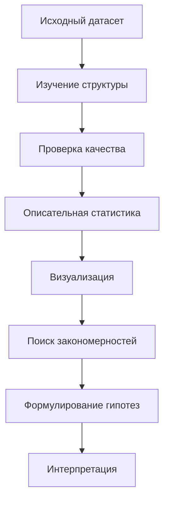
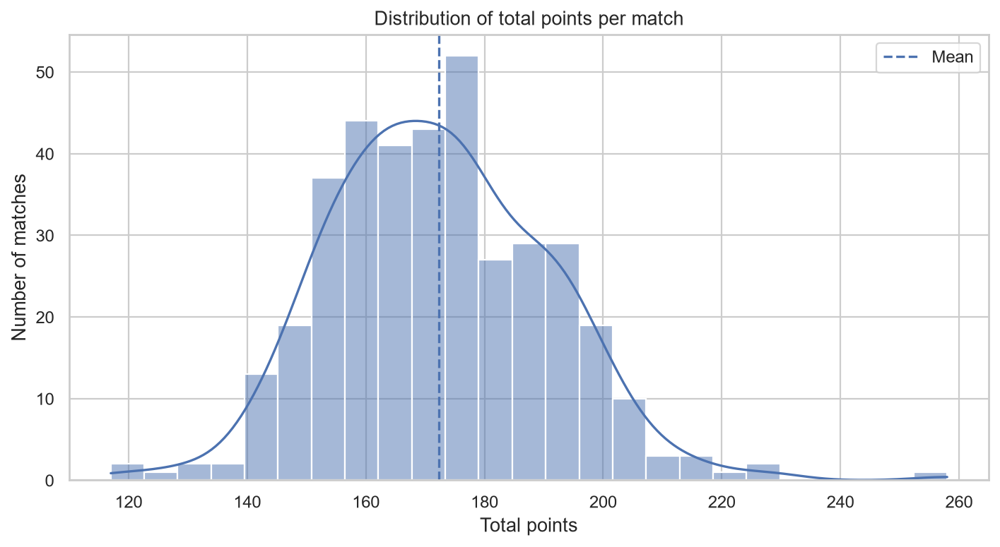
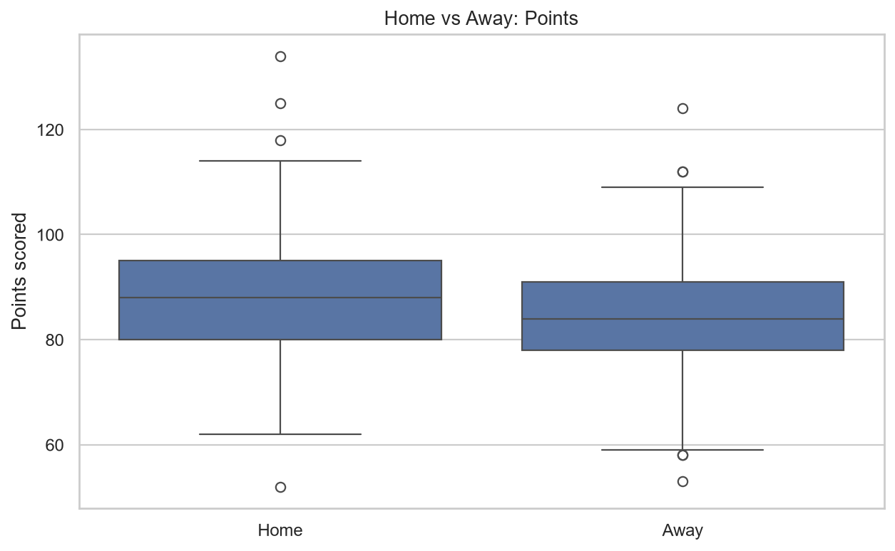
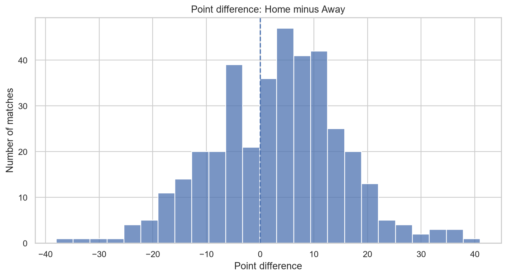
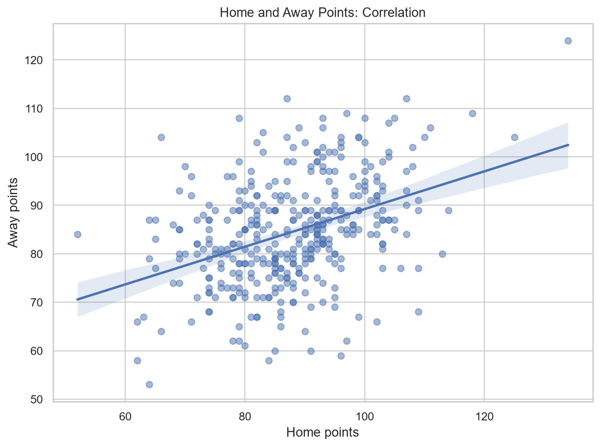
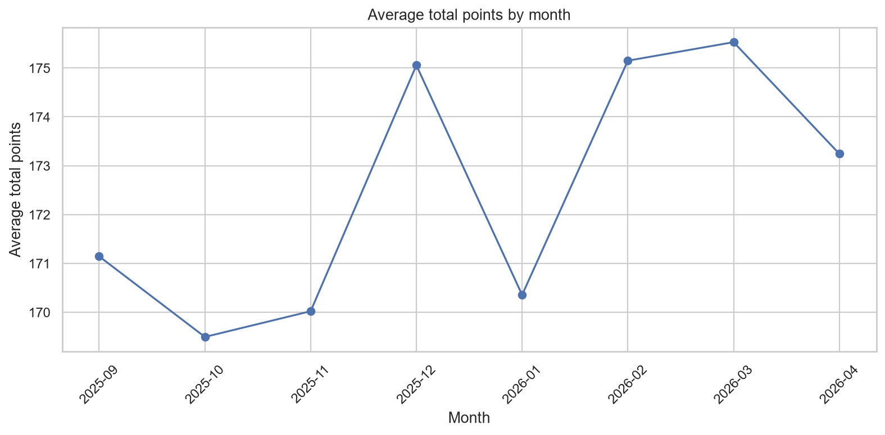
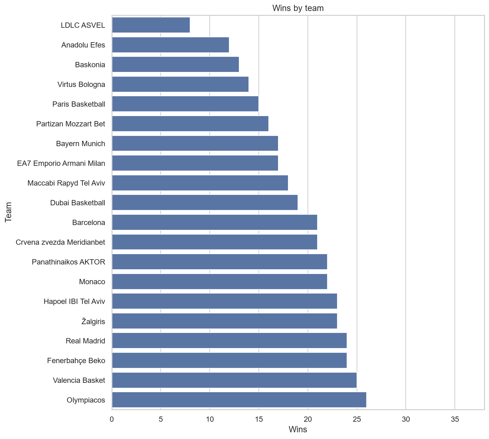

# Exploratory Data Analysis (EDA)

### Исследовательский анализ статистики Евролиги 2025/26

**Описательная статистика · Подробная математика · Код Python · 6 графиков · Проверка гипотез · Результаты программы**

---

## 1. Что такое EDA?

**Exploratory Data Analysis (EDA)** — исследовательский анализ данных, позволяющий изучить структуру датасета, обнаружить закономерности, выявить аномалии и сформулировать гипотезы.

В отличие от обычного просмотра таблицы, EDA использует статистические методы, визуализацию и исследование взаимосвязей между переменными.

Например, имея результаты 380 баскетбольных матчей, можно исследовать:

- Сколько очков в среднем набирают команды.
- Насколько сильно различается результативность матчей.
- Чаще ли выигрывают хозяева.
- Какие матчи имеют необычно высокий или низкий счёт.
- Связаны ли очки хозяев с очками гостей.
- Как менялась результативность в течение сезона.

### Основные этапы EDA



**Важное различие:** EDA помогает обнаруживать интересные закономерности, но не обязательно доказывает причинно-следственные связи.

Для проверки отдельных гипотез могут потребоваться дополнительные статистические методы.

### Как устроен доклад 


| Часть анализа | Где результат | Главный вопрос |
|---|---|---|
| Среднее, медиана, дисперсия, стандартное отклонение | **График №1** и консоль | Какова типичная результативность и разброс очков? |
| Распределение и KDE | **График №1** | Как часто встречаются разные суммы очков? |
| Квартили, IQR, потенциальные выбросы | **График №2**, поиск выбросов в консоли | Какие результаты необычны и как отличаются хозяева и гости? |
| Разница очков и домашнее преимущество | **График №3**, биномиальный тест и доверительный интервал в консоли | Чаще ли побеждают хозяева? |
| Корреляция и её значимость | **График №4** и консоль | Связаны ли очки хозяев и гостей? |
| Средняя результативность за месяц | **График №5** и помесячная таблица | Как изменялись результаты в течение сезона? |
| Победы и поражения команд | **График №6** и таблица команд | Кто чаще побеждал? |
| Самые результативные матчи, текст для LLM | **Вывод `eda_analysis.py`** | Какие дополнительные сведения извлечены из CSV? |


### Основные инструменты Python

- **Pandas (`pd`)** — обработка таблиц CSV, статистика и группировка.
- **NumPy (`np`)** — проверки числовых значений.
- **SciPy (`binomtest`, `pearsonr`)** — статистические тесты и корреляция.
- **Seaborn (`sns`)** — гистограммы, boxplot, регрессия и столбчатые графики.
- **Matplotlib (`plt`)** — оформление, подписи, линии и сохранение PNG.
- **`pathlib.Path`** — удобные пути к файлам проекта.

---

## 2. Исходные данные и подготовка признаков — основа всех графиков

В качестве источника используется CSV, полученный при парсинге результатов Евролиги 2025/26.

**Файл:** `data/processed/matches.csv`

Он содержит 380 матчей и пять исходных столбцов.

| Столбец | Содержание |
|---|---|
| `date` | Дата матча |
| `home_team` | Команда-хозяйка |
| `away_team` | Гостевая команда |
| `home_points` | Очки хозяев |
| `away_points` | Очки гостей |

### Загрузка данных

```python
df = pd.read_csv(
    DATA_PATH,
    encoding="utf-8-sig"
)
```

**Что делает код:** `pd` — сокращение библиотеки Pandas; `read_csv()` загружает CSV в объект **DataFrame**; `DATA_PATH` — полный путь к `data/processed/matches.csv`; `encoding="utf-8-sig"` помогает корректно прочитать UTF-8, в том числе с BOM; `df` — переменная с таблицей. В настоящем скрипте путь определяется через `pathlib.Path`, поэтому он не зависит от папки, из которой запускается программа.

### Первичное исследование

При загрузке необходимо проверить:

1. Размер таблицы.
2. Типы данных.
3. Пропущенные значения.
4. Повторяющиеся записи.
5. Корректность числовых значений.

Основные операции:

```python
df.shape
df.dtypes
df.isna().sum()
df.duplicated().sum()
```

**Что делает каждая операция:**

- `shape` — атрибут с количеством строк и столбцов: `(380, 5)` для исходного CSV.
- `dtypes` — тип данных по каждому столбцу.
- `isna()` — проверка отсутствующих значений; следующий `sum()` считает их по столбцам.
- `duplicated()` — определяет полностью повторяющиеся строки; `sum()` считает их количество.

Эти команды удобны при исследовании таблицы. Функции `load_data()` и `validate_data()` в `eda_analysis.py` выполняют более строгие проверки и прерывают программу при ошибках.

### Как именно программа проверяет CSV

```python
# Фрагменты из load_data() и validate_data()
missing_columns = set(required_columns) - set(df.columns)

if df[required_columns].isna().any().any():
    raise ValueError("В исходных данных есть пропуски!")

teams = set(df["home_team"]) | set(df["away_team"])
games_per_team = pd.concat(
    [df["home_team"], df["away_team"]]
).value_counts()
```

**Объяснение:** `set(...)` создаёт множество уникальных имён; `-` здесь означает разность множеств (находим отсутствующие столбцы); `|` объединяет команды хозяев и гостей; `pd.concat()` соединяет два столбца в один список участий; `value_counts()` подсчитывает игры каждой команды. `isna().any().any()` проверяет наличие хотя бы одного пропуска, а `raise ValueError` останавливает анализ.

Дополнительно код проверяет 380 матчей, 20 команд, 38 игр каждой команды, дубликаты строк и упорядоченных пар соперников, отсутствие матчей команды с собой, положительные целые очки и отсутствие ничьих. Даты парсятся через `parse_date()` в `pd.Timestamp`, а очки переводятся в целые числа только после проверки корректности.

Эти проверки важны, поскольку ошибочные или пропущенные значения могут исказить статистические показатели.

### Дополнительные признаки

Для анализа недостаточно только исходных столбцов.

Поэтому создаются четыре новых признака: суммарные очки, разница очков, домашняя победа и месяц матча.

**Общее количество очков — для графиков №1 и №5, статистики и выбросов:**

$$
T_i = H_i + A_i
$$

**Зачем:** суммируем очки двух команд, чтобы анализировать общую результативность матча. $T_i$ — сумма очков; $H_i$ — очки хозяев; $A_i$ — очки гостей; $i$ — номер конкретного матча. При счёте 103:87 получаем $T_i=190$.

**Разница очков — для графика №3 и средней величины домашнего преимущества:**

$$
D_i = H_i - A_i
$$

**Зачем:** знак разницы сразу показывает победителя. $D_i$ — разница очков, $H_i$ — очки хозяев, $A_i$ — очки гостей, $i$ — номер матча. Если $D_i>0$, победили хозяева; если $D_i<0$ — гости.

**Индикатор домашней победы — для биномиального теста, доли побед и командной статистики:**

$$
W_i = \mathbf{1}_{\{H_i>A_i\}}
$$

**Зачем:** превращаем результат матча в число, которое легко суммировать. $W_i=1$ при победе хозяев и $W_i=0$ при победе гостей; $\mathbf{1}$ — обозначение индикатора, а $i$ — номер матча.

Здесь используется индикаторная функция: она равна 1, если условие выполняется, и 0 в противном случае.

Обозначения:

- $H_i$ — очки хозяев в матче $i$.
- $A_i$ — очки гостей.
- $T_i$ — сумма очков обеих команд.
- $D_i$ — разница очков.
- $W_i$ — индикатор победы хозяев.

Реализация:

```python
df["total_points"] = (
    df["home_points"] + df["away_points"]
)

df["point_diff"] = (
    df["home_points"] - df["away_points"]
)

df["home_win"] = (
    df["home_points"] > df["away_points"]
)
```

**Разбор Python:** `df["имя"]` обращается к столбцу; присваивание создаёт новый столбец. `+` суммирует очки построчно, `-` вычисляет разницу, `>` сравнивает числа и возвращает `True`/`False`. В подсчёте побед `True` работает как 1, `False` как 0.

Четвёртый признак, который создаёт настоящая функция `create_features()`, — **месяц**:

```python
df["month"] = df["date"].dt.strftime("%Y-%m")
```

`dt` предоставляет операции с датами, а `strftime("%Y-%m")` превращает дату в строку вида `2026-03` для группировки по месяцам и графика №5. Перед созданием признаков `df.copy()` формирует копию исходной таблицы.

Эти признаки будут использоваться в дальнейшем анализе.

---

## 3. Описательная статистика — числа из консоли и график №1

**Описательная статистика (Descriptive Statistics)** — совокупность методов для краткого количественного описания данных.

Вместо просмотра всех 380 матчей можно рассчитать несколько характеристик распределения.

### 3.1. Среднее арифметическое

Среднее показывает центральный уровень числового признака. **Для чего в работе:** для линии среднего на графике №1, для таблицы описательной статистики и для среднего количества очков за месяц на графике №5.

$$
\bar{x} = \frac{1}{n}\sum_{i=1}^{n}x_i
$$

**Как читать:** $x_i$ — сумма очков в матче $i$; $n=380$ — число матчей; $\sum$ — сложение всех значений от первого до последнего; $\bar{x}$ — среднее. Мы складываем очки всех матчей и делим на число матчей.

где:

- $n$ — количество наблюдений.
- $x_i$ — значение признака.
- $\bar{x}$ — среднее арифметическое.

Для наших данных $x_i$ — общее количество очков в матче.

Пример на условных данных:

$$
x = (160,170,180)
$$

$$
\bar{x} = \frac{160+170+180}{3} = 170
$$

В Python:

```python
df["total_points"].mean()
```

`df["total_points"]` выбирает столбец, `.mean()` считает его среднее. В нашем CSV получается **172,33 очка**. Отдельную формулу в Python писать не нужно: Pandas уже реализует вычисление.

### 3.2. Медиана

**Медиана** — значение, разделяющее упорядоченный набор наблюдений на две равные по количеству части. **Зачем:** она помогает описать центр распределения на графике №1 и служит центральной линией на boxplot №2. В программе вызывается метод `.median()`; по суммарным очкам медиана равна **171,50**.

Для последовательности:

$$
(160,170,180)
$$

медиана равна 170.

Если количество наблюдений чётное, медиану обычно вычисляют как среднее двух центральных значений.

Медиана менее чувствительна к экстремальным значениям, чем арифметическое среднее.

Например:

$$
(160,170,300)
$$

Среднее:

$$
\bar{x} = 210
$$

Медиана:

$$
Me = 170
$$

Экстремальное значение существенно изменило среднее, но не медиану.

### 3.3. Дисперсия

Среднее показывает центральное значение распределения, но не характеризует разброс наблюдений.

Для этого используется **дисперсия**. **Зачем:** она количественно дополняет график №1, показывая масштаб разброса суммарных очков, а не только их среднее.

Выборочная дисперсия:

$$
s^2 = \frac{1}{n-1}\sum_{i=1}^{n}(x_i-\bar{x})^2
$$

**Обозначения:** $s^2$ — **выборочная дисперсия**; $x_i$ — сумма очков в матче $i$; $\bar{x}$ — средняя сумма очков; $n$ — количество матчей; $\sum$ — суммирование. Сначала считаем отклонение каждого матча от среднего, возводим в квадрат, складываем, делим на $n-1$.

Здесь применяется знаменатель $n-1$, то есть **поправка Бесселя**. В Python это параметр `ddof=1`.

**Почему так:** выборочное среднее было получено из тех же данных. При стандартных предпосылках случайной выборки деление на $n-1$ компенсирует систематическое занижение оценки дисперсии генеральной совокупности. Если считать ровно все 380 матчей отдельной конечной совокупностью, её дисперсию можно считать с делением на $n$; в программе выбран выборочный вариант.

Она делает выборочную дисперсию несмещённой оценкой дисперсии генеральной совокупности при стандартных предпосылках случайной выборки.

Для условного набора:

$$
(160,170,180)
$$

при среднем 170:

$$
s^2 = \frac{(-10)^2+0^2+10^2}{2} = 100
$$

Дисперсия измеряется в квадрате единиц исходного признака.

### Математический смысл дисперсии

В теории вероятностей дисперсия случайной величины определяется через математическое ожидание:

$$
D(X) = E[(X-E(X))^2]
$$

**Зачем эта более теоретическая запись:** она объясняет, откуда берётся сама идея разброса, но **не используется непосредственно** в коде построения графика. $X$ — случайная результативность матча; $E(X)$ — её математическое ожидание, то есть теоретическое среднее; $D(X)$ — теоретическая дисперсия; $E[\ldots]$ — математическое ожидание выражения в скобках. Внутри стоит квадрат отклонения от среднего.

Здесь:

- $X$ — случайная величина.
- $E(X)$ — её математическое ожидание.
- $D(X)$ — дисперсия.

Математическое ожидание характеризует центр распределения случайной величины, а дисперсия показывает средний квадрат отклонения от этого центра.

Существует эквивалентная формула:

$$
D(X) = E(X^2)-[E(X)]^2
$$

**Смысл и переменные:** $E(X^2)$ — среднее квадрата случайной величины, $[E(X)]^2$ — квадрат её среднего, $D(X)$ — дисперсия. Это **эквивалентная формула**, удобная для алгебраических преобразований, а не новая статистическая характеристика.

Она следует из раскрытия квадрата:

$$
(X-E(X))^2 = X^2-2XE(X)+[E(X)]^2
$$

Здесь раскрывается квадрат разности по школьной формуле $(a-b)^2=a^2-2ab+b^2$, где $a=X$, $b=E(X)$. **Для графиков этот вывод не нужен** — он добавлен для понимания математики и ответа на возможный вопрос преподавателя.

После применения линейности математического ожидания получаем формулу дисперсии.

Таким образом, дисперсия связана не только с обработкой числовых данных, но и с фундаментальными понятиями теории вероятностей.

**Важно:** выборочная дисперсия $s^2$ и теоретическая дисперсия $D(X)$ — связанные, но не тождественные понятия.

Первая вычисляется по наблюдениям, вторая относится к распределению случайной величины.

### 3.4. Стандартное отклонение

**Стандартное отклонение** — квадратный корень из дисперсии.

$$
s = \sqrt{s^2}
$$

**Зачем:** стандартное отклонение измеряется в **очках**, поэтому его легче объяснить по графику №1. $s^2$ — выборочная дисперсия, $s$ — стандартное отклонение; знак $\sqrt{\cdot}$ означает квадратный корень. У нас $s\approx18{,}49$ очка при $s^2\approx341{,}95$.

В предыдущем примере:

$$
s = \sqrt{100} = 10
$$

В отличие от дисперсии, стандартное отклонение измеряется в исходных единицах признака.

Для наших данных — в очках.

### 3.5. Практическая реализация

```python
points = df["total_points"]

mean = points.mean()
median = points.median()
variance = points.var(ddof=1)
std = points.std(ddof=1)
```

**Разбор кода:** `points` — серия Pandas с суммарными очками; `.mean()` — среднее (**172,33**); `.median()` — медиана (**171,50**); `.var(ddof=1)` — выборочная дисперсия (**341,95**); `.std(ddof=1)` — стандартное отклонение (**18,49**). Аргумент `ddof=1` включает поправку Бесселя: знаменатель $n-1$. Эти числа показываются в консоли и итоговой таблице, а среднее — ещё и вертикальной линией на графике №1.

`ddof=1` указывает на использование знаменателя $n-1$.

### 3.6. Стандартная ошибка среднего

Стандартное отклонение характеризует разброс отдельных наблюдений, но не показывает, насколько точно оценено среднее значение.

Для этого используется **стандартная ошибка среднего (Standard Error of the Mean, SEM)**. **Зачем:** отличать разброс отдельных матчей от неопределённости оценки среднего. Этот показатель **не вычисляется отдельной строкой в `eda_analysis.py`** и не показывается на графиках — это дополнительная теория.

При независимых и одинаково распределённых наблюдениях она оценивается по формуле:

$$
SE(\bar{x}) = \frac{s}{\sqrt{n}}
$$

**Обозначения:** $SE(\bar{x})$ — оценка стандартной ошибки среднего; $s$ — выборочное стандартное отклонение; $n$ — объём выборки, здесь 380; $\bar x$ — выборочное среднее. Чем больше число независимых наблюдений, тем обычно меньше ошибка оценки среднего при прочих равных.

где:

- $s$ — выборочное стандартное отклонение.
- $n$ — количество наблюдений.
- $SE(\bar{x})$ — стандартная ошибка среднего.

В нашем датасете:

$$
n = 380
$$

$$
s \approx 18.49
$$

Поэтому:

$$
SE(\bar{x}) \approx \frac{18.49}{\sqrt{380}} \approx 0.95
$$

При выполнении статистических предпосылок стандартная ошибка оценки среднего составляет приблизительно 0,95 очка.

Это не означает, что отдельные матчи отличаются от среднего всего на 0,95 очка.

Их разброс значительно больше — около 18,49 очка по стандартному отклонению.

## 4. Исследование распределения — график №1

### Что такое распределение?

Распределение показывает, как часто встречаются различные значения признака.

В нашем случае можно исследовать распределение общего количества очков за матч.

Для визуализации используется **гистограмма (Histogram)**. **Связь с графиком №1:** ось X — общее число очков за матч, ось Y — число матчей в заданном интервале.

### Гистограмма результативности



**На самом графике:** столбцы — частоты результатов, плавная линия — KDE (оценка плотности), вертикальный пунктир — среднее число очков **172,33**. Диапазон наблюдаемых сумм: от **117** до **258**.

Гистограмма позволяет оценить:

- Где сосредоточено большинство матчей.
- Насколько широк разброс значений.
- Есть ли асимметрия распределения.
- Встречаются ли экстремальные результаты.
- Похоже ли распределение на нормальное.

Важно: внешнее сходство гистограммы с нормальным распределением не является доказательством нормальности.

### Среднее и медиана

Сравнение этих показателей помогает оценить асимметрию.

Например, если:

$$
\bar{x} > Me
$$

Здесь $\bar{x}$ — среднее, $Me$ — медиана. **Зачем сравниваем:** это один из быстрых признаков возможной асимметрии на графике №1; строго определить форму распределения только по этой паре чисел нельзя.

это может свидетельствовать о наличии относительно крупных значений, смещающих среднее вправо.

Но одного такого сравнения недостаточно для строгого вывода о форме распределения.

### 4.1. KDE — ядерная оценка плотности

На нашем первом графике, помимо гистограммы, отображается плавная линия.

Она построена с помощью **Kernel Density Estimation (KDE)** — метода ядерной оценки плотности распределения.

В отличие от гистограммы, которая разбивает значения на интервалы, KDE строит сглаженную оценку плотности вероятности.

Общая формула:

$$
\hat{f}_h(x) = \frac{1}{nh}\sum_{i=1}^{n}K\left(\frac{x-x_i}{h}\right)
$$

**Зачем формула KDE:** математически объяснить **плавную линию графика №1**. $\hat f_h(x)$ — оценка плотности в выбранной точке $x$; $x_i$ — значение суммарных очков матча $i$; $n$ — число матчей; $K$ — функция ядра; $h>0$ — ширина сглаживания; $\sum$ — суммирование вкладов всех наблюдений. В коде эту процедуру уже реализует Seaborn; вручную её считать не нужно.

Здесь:

- $\hat{f}_h(x)$ — оценка плотности в точке $x$.
- $n$ — количество наблюдений.
- $x_i$ — отдельное наблюдение.
- $K$ — ядерная функция.
- $h$ — параметр ширины сглаживания (bandwidth).


### Почему важен параметр h?

Если $h$ слишком маленький, оценка плотности становится неровной и чувствительной к отдельным наблюдениям.

Если $h$ слишком большой, распределение чрезмерно сглаживается, из-за чего могут исчезнуть важные особенности.

В нашей программе KDE включается параметром kde=True. Ширина сглаживания \(h\) не задаётся вручную, а автоматически определяется библиотекой с использованием правила Скотта. Для нашего датасета примерно 5,64 очка.

В нашей программе используется:

```python
sns.histplot(
    data=df,
    x="total_points",
    bins=25,
    kde=True
)
```

**Разбор Python:** `sns.histplot()` — статистическая гистограмма; `data=df` — источник данных; `x="total_points"` — столбец для оси X; `bins=25` — 25 интервалов по оси X; `kde=True` — поверх столбцов рисуется сглаженная оценка плотности.

В `build_charts()` дополнительно используются:

```python
plt.axvline(df["total_points"].mean(), linestyle="--", label="Mean")
save_chart("01_points_distribution.png")
```

`plt.axvline()` рисует вертикальную пунктирную линию на среднем. Наша функция `save_chart()` вызывает `plt.tight_layout()`, `plt.savefig(..., dpi=160, bbox_inches="tight")` и `plt.close()`: подгоняет расположение элементов, сохраняет PNG и закрывает рисунок.

Параметр `kde=True` добавляет сглаженную оценку плотности.

**Важное различие:** гистограмма и KDE показывают одну и ту же выборку, но представляют её разными способами.

---

## 5. Квантили и выбросы — график №2 и вывод программы

### 5.1. Квантили

**Квантиль** — значение, разделяющее упорядоченные данные в заданной пропорции.

Основные квартили:

- $Q_1$ — первый квартиль (25%).
- $Q_2$ — медиана (50%).
- $Q_3$ — третий квартиль (75%).

Межквартильный размах:

$$
IQR = Q_3-Q_1
$$

**Обозначения:** $Q_1$ — первый квартиль (25%), $Q_3$ — третий квартиль (75%), $IQR$ — межквартильный размах. Разница показывает диапазон центральной половины наблюдений.

Он характеризует разброс центральных 50% наблюдений. **Зачем:** именно квартили определяют края прямоугольника на boxplot №2, а IQR нужен для поиска выбросов, выводимых программой.

### 5.2. Правило 1,5 IQR

Для обнаружения потенциальных выбросов часто используются границы:

$$
L = Q_1-1.5\cdot IQR
$$

$$
U = Q_3+1.5\cdot IQR
$$

**Зачем две границы:** найти необычно малые и большие результаты. $L$ — нижний порог, $U$ — верхний; $Q_1$, $Q_3$ — квартили, $IQR=Q_3-Q_1$ — их разность; коэффициент $1{,}5$ — принятое в разведочном анализе правило Тьюки, а не «допустимая спортивная норма».

Наблюдение рассматривается как потенциальный выброс, если:

$$
x_i < L \quad \text{или} \quad x_i > U
$$

$x_i$ — суммарное число очков конкретного матча $i$. Если оно вне промежутка $[L,U]$, программа помечает матч как **потенциальный** выброс. Для суммарных очков пороги оказались 120 и 224; таких матчей четыре.

**Важно:** выброс не обязательно является ошибкой.

Например, матч с необычно большим количеством очков может быть совершенно реальным.

### Математический пример на наших данных

После анализа 380 матчей были получены:

$$
Q_1 = 159
$$

$$
Q_3 = 185
$$

Следовательно:

$$
IQR = 185-159 = 26
$$

Нижняя граница:

$$
L = 159-1.5\cdot26 = 120
$$

Верхняя граница:

$$
U = 185+1.5\cdot26 = 224
$$

Таким образом, потенциальными выбросами по общему количеству очков считаются матчи, в которых:

- Набрано меньше 120 очков.
- Набрано больше 224 очков.

В нашем датасете таких матчей **4**.

Правило IQR не требует предположения о нормальности распределения, поэтому является удобным инструментом предварительного исследования данных.

### 5.3. Boxplot



**Оси графика №2:** X — `Home` и `Away`; Y — очки, набранные одной командой. Горизонтальная линия внутри ящика — медиана; границы коробки — $Q_1$ и $Q_3$; отдельные точки за усами — потенциальные выбросы для **этой группы**. Усы - диапазоны обычных значений, фигура - центральные 50% результатов

### Как программа находит выбросы и строит график

```python
q1 = float(points.quantile(0.25))
q3 = float(points.quantile(0.75))
iqr = q3 - q1
lower_bound = q1 - 1.5 * iqr
upper_bound = q3 + 1.5 * iqr

outliers = df[(points < lower_bound) | (points > upper_bound)].copy()
```

**Разбор кода:** `.quantile(0.25)` и `.quantile(0.75)` находят первый и третий квартили; `|` означает логическое «ИЛИ»; `df[условие]` выбирает строки, где условие истинно; `.copy()` создаёт отдельный DataFrame с найденными матчами. Количество строк `len(outliers)` попадает в консоль и таблицу результатов.

```python
score_data = df[["home_points", "away_points"]].rename(
    columns={"home_points": "Home", "away_points": "Away"}
).melt(var_name="Side", value_name="Points")

sns.boxplot(data=score_data, x="Side", y="Points")
save_chart("02_home_away_boxplot.png")
```

**Разбор кода:** `rename()` задаёт короткие подписи сторон; `melt()` превращает два отдельных столбца в формат «сторона / очки», необходимый для удобной группировки; `sns.boxplot()` строит сравнительные ящики; `save_chart()` сохраняет PNG.

**Важное различие:** четыре найденных выброса относятся к **сумме очков за матч** (`total_points`), а точки на графике №2 — к распределениям **очков хозяев и гостей по отдельности**. Эти множества выбросов не обязаны совпадать.

**Boxplot** визуализирует распределение с помощью медианы, квартилей, усов и отдельных потенциальных выбросов.

С его помощью можно сравнить результативность хозяев и гостей.

При этом необычные значения нужно исследовать, а не автоматически удалять.

---

## 6. Домашнее преимущество — график №3 и биномиальный тест

Один из интересных вопросов спортивной аналитики: **чаще ли выигрывают команды на домашней площадке?** Для ответа программа использует **график №3**, число побед, биномиальный тест и доверительный интервал, выводимые в консоль.

### 6.1. Доля побед хозяев

Введём индикатор:

$$
W_i = \mathbf{1}_{\{\text{победа хозяев в матче }i\}}
$$

**Обозначения:** $W_i$ — индикатор (1 или 0) результата матча $i$; $i$ — номер матча; $\mathbf1$ — индикаторная функция. **Зачем:** сумма таких значений равна числу домашних побед.

Он равен 1 при победе хозяев и 0 при победе гостей.

Тогда наблюдаемая доля побед хозяев:

$$
\hat{p} = \frac{1}{n}\sum_{i=1}^{n}W_i
$$

**Зачем:** получаем наблюдаемую долю домашних побед для графика №3 и проверки гипотезы. $\hat p$ — доля побед хозяев; $W_i$ — 1 при их победе и 0 в противном случае; $n=380$ — число матчей; $\sum W_i=242$ — количество побед. Поэтому $\hat p=242/380\approx0{,}6368$, то есть **63,68%**.

Здесь $n=380$.

В Python:

```python
home_wins = df["home_win"].sum()
home_win_rate = home_wins / len(df)
```

**Разбор Python:** `sum()` складывает булевы значения `True`/`False` как 1/0; `home_wins` хранит число домашних побед; `len(df)` — число всех матчей; `/` делит число побед на число матчей. В программе также вычисляются `away_wins = n - home_wins` и средняя разница `df["point_diff"].mean()` — она равна **+3,34 очка**.


### 6.2. Визуализация разницы очков



**Что показывает график №3:** по оси X — разница `home_points - away_points`, по оси Y — число матчей. Положительные значения справа от нуля — домашние победы, отрицательные слева — гостевые.

```python
sns.histplot(data=df, x="point_diff", bins=25)
plt.axvline(0, linestyle="--")
save_chart("03_point_difference.png")
```

**Разбор Python:** `sns.histplot()` считает частоты значений разницы в 25 интервалах; `plt.axvline(0)` проводит нулевую границу, отделяющую победы хозяев от побед гостей; `save_chart()` записывает изображение.

Если разница очков положительна, победили хозяева.

Если отрицательна — гости.

Средняя разница:

$$
\overline{D} = \frac{1}{n}\sum_{i=1}^{n}(H_i-A_i)
$$

**Обозначения:** $\overline D$ — средняя разница очков; $H_i$ — очки хозяев матча $i$; $A_i$ — очки гостей; $n$ — число матчей; $\sum$ — сумма разниц. **Зачем:** процент побед говорит, *как часто* выигрывают хозяева, а $\overline D\approx+3{,}34$ — *насколько в среднем по очкам* они опережают гостей.

Она дополняет анализ доли побед, поскольку учитывает величину преимущества.

### 6.3. Математическое ожидание и дисперсия числа побед

Для биномиального распределения:

$$
X\sim Bin(n,p)
$$

Здесь $X$ — случайное **количество домашних побед** за сезон; $n=380$ — число матчей; $p$ — вероятность домашней победы в каждом испытании; $Bin(n,p)$ — биномиальное распределение. **Зачем:** это математическая модель, на которой основан `binomtest()`.

математическое ожидание имеет вид:

$$
E(X) = np
$$

**Обозначения:** $E(X)$ — математическое ожидание числа домашних побед; $n$ — число матчей; $p$ — модельная вероятность. **Зачем:** сравниваем фактические 242 победы с **190**, которые ожидались бы при $p=0{,}5$.

Дисперсия:

$$
D(X) = np(1-p)
$$

Здесь $D(X)$ — теоретическая дисперсия **числа домашних побед** (не дисперсия очков!); $n$ — число матчей, $p$ — вероятность одной победы. **Зачем:** оценить ожидаемый разброс числа побед вокруг 190 при нулевой модели.

Стандартное отклонение:

$$
\sigma_X = \sqrt{np(1-p)}
$$

$\sigma_X$ — теоретическое стандартное отклонение числа домашних побед; $n$ — число испытаний, $p$ — вероятность победы. При $n=380$ и $p=0{,}5$ оно равно примерно **9,75 победы**. Это дополнительное обоснование значимости, а не отдельный расчёт, выводимый нашим скриптом.

Предположим, что нулевая гипотеза верна:

$$
p = 0.5
$$

При 380 матчах ожидаемое число домашних побед:

$$
E(X) = 380\cdot0.5 = 190
$$

Стандартное отклонение:

$$
\sigma_X = \sqrt{380\cdot0.5\cdot0.5} \approx 9.75
$$

Фактически хозяева победили 242 раза.

Это на 52 победы больше, чем ожидалось при нулевой гипотезе.


### Ограничения

Матчи одной команды могут быть статистически зависимыми: у них общие игроки, тренеры и другие факторы.

Поэтому предположение независимости и одинаковой вероятности в простом биномиальном тесте является упрощением.

Кроме того, выявленная связь между домашней площадкой и результатом не доказывает причинное воздействие самой площадки.

---

## 7. Корреляционный анализ — график №4

### Что такое корреляция?

**Корреляция** характеризует статистическую связь между переменными.

В нашем случае исследуется связь между количеством очков хозяев и гостей в одном матче. **Зачем:** объяснить наклон облака точек на графике №4 и вывести коэффициент корреляции и p-value в консоль.

### Коэффициент корреляции Пирсона

$$
r = \frac{\sum_{i=1}^{n}(x_i-\bar{x})(y_i-\bar{y})}{\sqrt{\sum_{i=1}^{n}(x_i-\bar{x})^2\sum_{i=1}^{n}(y_i-\bar{y})^2}}
$$

**Как читать:** $r$ — корреляция Пирсона; $n=380$ — число пар очков; $x_i$ — очки хозяев, $y_i$ — очки гостей матча $i$; $\bar x$ и $\bar y$ — их средние; $\sum$ — суммирование. В числителе — совместное отклонение двух команд от своих средних; знаменатель нормирует результат, чтобы $r$ лежал между −1 и 1.

**Зачем:** оценить **направление и силу линейной связи** на графике №4, а не предсказать точный счёт или доказать причинность.

Коэффициент Пирсона измеряет направление и силу линейной связи между двумя числовыми признаками. В нашем случае это очки хозяев и гостей. Сначала мы смотрим, как значения отклоняются от своих средних, затем анализируем их совместные отклонения и нормируем результат. Получили коэффициент 0,3947, что говорит об умеренной положительной связи.

Здесь:

- $x_i$ — очки хозяев.
- $y_i$ — очки гостей.
- $\bar{x}$ и $\bar{y}$ — соответствующие средние.

Коэффициент находится в пределах:

$$
-1 \le r \le 1
$$

### Интерпретация

| Значение | Общий смысл |
|---|---|
| $r>0$ | Положительная линейная связь |
| $r<0$ | Отрицательная линейная связь |
| $r\approx0$ | Слабая или отсутствующая линейная связь |
| $r=1$ | Идеальная положительная линейная связь |
| $r=-1$ | Идеальная отрицательная линейная связь |

Значение около нуля не исключает нелинейной зависимости.

### Реализация

```python
correlation, p_value = pearsonr(
    df["home_points"],
    df["away_points"]
)
```

**Разбор Python:** `pearsonr()` из SciPy принимает две последовательности чисел одинаковой длины; возвращает коэффициент корреляции (`correlation`) и p-value (`p_value`) для проверки отсутствия корреляции при статистических предпосылках. В наших данных $r\approx0{,}3947$: **умеренная положительная** линейная связь.

### Диаграмма рассеяния



**Как построен график №4:** каждая точка — один матч, X — очки хозяев, Y — очки гостей. Добавлена линия линейной регрессии (общая тенденция), а не «линия корреляции». Положительный наклон соответствует положительной корреляции Пирсона 0,3947. Но заметный разброс точек показывает, что связь умеренная, а не сильная

```python
sns.regplot(
    data=df,
    x="home_points",
    y="away_points",
    scatter_kws={"alpha": 0.5}
)
save_chart("04_correlation.png")
```

**Разбор Python:** `sns.regplot()` строит диаграмму рассеяния и линейную регрессионную линию; `scatter_kws` настраивает точки; `alpha=0.5` делает их полупрозрачными, чтобы перекрытия лучше читались. Доверительная область вокруг регрессионной линии визуализируется автоматически при стандартных настройках Seaborn.

На графике каждая точка соответствует одному матчу.

Горизонтальная ось — очки хозяев.

Вертикальная ось — очки гостей.

Линия показывает линейную тенденцию, полученную методом регрессии.

### 7.1. Ковариация

Чтобы глубже понять коэффициент Пирсона, необходимо рассмотреть понятие **ковариации**.

Ковариация характеризует направление совместного изменения двух случайных величин.

Теоретическая ковариация:

$$
Cov(X,Y) = E[(X-E(X))(Y-E(Y))]
$$

**Обозначения:** $X$ и $Y$ — случайные очки хозяев и гостей; $E(X)$ и $E(Y)$ — их теоретические средние; $Cov(X,Y)$ — ковариация; $E[\ldots]$ — математическое ожидание произведения отклонений. **Зачем:** понять, почему при совместном росте очков корреляция положительна.

Выборочная ковариация:

$$
s_{xy} = \frac{1}{n-1}\sum_{i=1}^{n}(x_i-\bar{x})(y_i-\bar{y})
$$

Здесь $s_{xy}$ — **выборочная** ковариация; $x_i$, $y_i$ — парные очки команд в матче $i$; $\bar x$, $\bar y$ — их средние; $n$ — число матчей. **Зачем:** вычислить совместное изменение по наблюдаемым данным, а затем нормировать его для корреляции Пирсона.

Если ковариация положительна, большие значения одной переменной чаще сопровождаются большими значениями другой.

Если отрицательна — увеличение одной переменной чаще сопровождается уменьшением другой.

Однако ковариация зависит от масштаба переменных.

Поэтому для сравнения силы линейной связи используется нормированный показатель — корреляция Пирсона.

### 7.2. Связь корреляции с ковариацией

Коэффициент корреляции можно представить как:

$$
r = \frac{s_{xy}}{s_xs_y}
$$

**Обозначения:** $r$ — корреляция; $s_{xy}$ — выборочная ковариация; $s_x$ — стандартное отклонение очков хозяев; $s_y$ — стандартное отклонение очков гостей. **Зачем:** стандартизация устраняет зависимость ковариации от единиц измерения и приводит результат к диапазону от −1 до 1.

где:

- $s_{xy}$ — выборочная ковариация.
- $s_x$ — выборочное стандартное отклонение первой переменной.
- $s_y$ — выборочное стандартное отклонение второй переменной.

Таким образом, корреляция — это нормированная ковариация.

Деление на произведение стандартных отклонений устраняет зависимость от единиц измерения.


### Важное замечание

**Корреляция не означает причинность.**

Например, высокая общая результативность может быть связана с темпом игры, количеством владений или особенностями команд.

Нельзя сделать вывод, что увеличение очков хозяев само по себе вызывает увеличение очков гостей.

---

## 8. Анализ временных изменений — график №5

EDA позволяет исследовать изменение показателей во времени.

В нашем случае можно рассмотреть среднее количество очков за матч в разные месяцы сезона. **Связь с графиком №5:** по горизонтали — месяцы, по вертикали — средняя сумма очков в матчах конкретного месяца.

Для месяца $m$:

$$
\bar{T}_m = \frac{1}{n_m}\sum_{i\in I_m}T_i
$$

**Обозначения:** $\bar T_m$ — средняя сумма очков за месяц $m$; $I_m$ — множество матчей, сыгранных в этом месяце; $i\in I_m$ — перебираем только матчи данного месяца; $T_i$ — суммарные очки матча $i$; $n_m$ — число матчей в месяце. **Зачем:** сравнивать месяцы при неодинаковом количестве игр — используем среднее, а не просто сумму очков.

где:

- $I_m$ — множество матчей соответствующего месяца.
- $n_m$ — их количество.
- $T_i$ — общее количество очков в матче.

### Реализация

```python
monthly = (
    df.groupby("month", as_index=False)
    .agg(
        avg_total_points=("total_points", "mean"),
        matches=("total_points", "size")
    )
)
```

**Разбор Python:** `groupby("month", as_index=False)` объединяет строки по месяцу и оставляет месяц обычным столбцом; `.agg()` рассчитывает сразу несколько агрегатов; `("total_points", "mean")` — среднее очков за месяц, `("total_points", "size")` — количество игр. В полной функции `monthly_analysis()` после этого вызывается `.sort_values("month")`, чтобы месяцы шли по порядку.

### График по месяцам



```python
plt.plot(
    monthly["month"],
    monthly["avg_total_points"],
    marker="o"
)
plt.xticks(rotation=45)
save_chart("05_monthly_trend.png")
```

**Разбор Python:** `plt.plot()` строит линейный график; первая серия — месяцы по X, вторая — среднемесячная результативность по Y; `marker="o"` рисует точки; `rotation=45` поворачивает подписи; `save_chart()` создаёт PNG.

**Наш результат:** минимум средних значений — **169,49** в октябре 2025, максимум — **175,53** в марте 2026. Разница небольшая; вертикальная ось начинается не с нуля, поэтому визуальные колебания могут казаться сильнее реальных. Число игр по месяцам неодинаково — сравнение требует осторожности.

Этот график показывает, как менялась средняя результативность.

Но изменение среднего может быть связано не только со временем, а также с составом матчей, изменениями составов команд и другими факторами.

Поэтому временную динамику следует интерпретировать осторожно.

---

## 9. Сравнение команд — график №6

На основе исходного CSV можно вычислить статистику каждой команды. **Связь с графиком №6:** показываем число побед 20 команд; более подробная таблица с победами, поражениями, долями и средними очками выводится в консоль.

В частности:

- Количество побед.
- Количество поражений.
- Долю побед.
- Среднее число набранных очков.
- Среднее число пропущенных очков.

### Доля побед

Для команды $j$:

$$
WinRate_j = \frac{W_j}{M_j}
$$

**Обозначения:** $WinRate_j$ — доля побед команды $j$; $W_j$ — её число побед; $M_j$ — число сыгранных ею матчей (у каждой команды в CSV 38); $j$ — номер команды. **Зачем:** сравнивать доли побед; сам график №6 показывает **число** побед, а не долю.

где:

- $W_j$ — количество побед команды.
- $M_j$ — количество сыгранных матчей.

### Средние набранные очки

$$
\overline{PF}_j = \frac{1}{M_j}\sum_{i=1}^{M_j}PF_{ij}
$$

**Обозначения:** $\overline{PF}_j$ — средние **набранные** очки команды $j$; $PF_{ij}$ — её очки в матче $i$; $M_j$ — число её матчей. Аналогично средние пропущенные очки рассчитываются по `points_allowed`. **Зачем:** расширить анализ команды за пределы побед и поражений; значения печатаются в консольной таблице, но не нанесены на график №6.

Здесь $PF_{ij}$ — количество очков, набранных командой $j$ в матче $i$.

Аналогично рассчитываются средние пропущенные очки.

### Победы команд



### Как программа считает командную статистику

```python
home = df[df["home_team"] == team]
away = df[df["away_team"] == team]

games = len(home) + len(away)
wins_home = int(home["home_win"].sum())
wins_away = int((~away["home_win"]).sum())

wins = wins_home + wins_away
losses = games - wins
```

**Разбор Python:** `df[условие]` фильтрует строки по команде; `home` и `away` — её домашние и гостевые матчи; `len(...)` — число строк; `.sum()` считает домашние победы; `~` инвертирует булевы значения и позволяет посчитать гостевые победы; затем считаются общие победы и поражения. В полной функции также рассчитываются набранные, пропущенные и средние очки, а команды сортируются по победам и средней разнице очков.

```python
sorted_teams = team_stats.sort_values("wins")
sns.barplot(data=sorted_teams, x="wins", y="team")
plt.xlim(0, 38)
save_chart("06_team_wins.png")
```

**Разбор Python:** `sort_values("wins")` сортирует команды для горизонтального графика; `sns.barplot()` строит столбцы; `x` задаёт число побед, `y` — команду; `xlim(0, 38)` ограничивает ось возможным числом игр; `save_chart()` сохраняет PNG.

**Наш результат:** больше всего побед у **Olympiacos (26)** и **Valencia Basket (25)**, меньше всего — у **LDLC ASVEL (8)**.

Полученная таблица отражает статистику команд по данным CSV.

**Она не является официальной турнирной таблицей Евролиги**, поскольку официальные правила ранжирования могут включать дополнительные критерии.

---

## 10. Применение EDA в LLM

EDA применяется не только к спортивной статистике. Здесь **нет отдельного графика**: раздел показывает дополнительный вывод в консоли и связь разведочного анализа с качеством данных для языковых моделей.

Исследовательский анализ данных важен при подготовке и проверке информации для больших языковых моделей.

### 10.1. Проверка обучающих корпусов

Перед обучением языковой модели можно исследовать:

- Распределение длин документов.
- Долю текстов на разных языках.
- Наличие пропусков и повреждённых записей.
- Количество дубликатов.
- Распределение категорий документов.
- Наличие выбросов и аномалий.

Эти задачи концептуально похожи на проверку спортивного датасета.

Например, ошибка с двумя названиями Baskonia показывает, как разные обозначения одного объекта могут искажать статистику.

### 10.2. Анализ распределений

В спортивном датасете можно исследовать распределение очков.

В текстовом корпусе — распределение длин документов или частот токенов.

Для обоих случаев могут использоваться гистограммы, квантили, средние значения и меры разброса.

### 10.3. Data Distribution Shift

**Distribution Shift** — изменение статистического распределения данных между различными наборами или периодами наблюдения.

Например, распределение длин текстов в новом наборе может отличаться от распределения обучающего корпуса.

Формально можно рассматривать:

$$
P_{\text{train}}(X) \ne P_{\text{new}}(X)
$$

**Обозначения:** $P_{\text{train}}(X)$ — распределение признака $X$ в обучающих данных; $P_{\text{new}}(X)$ — распределение того же признака в новых данных; знак $\ne$ означает различие. Например, $X$ может быть длиной документа. **Зачем:** показать, что подходы EDA применимы к текстовым данным. Программа **не вычисляет** distribution shift для Евролиги.

Здесь $X$ — рассматриваемый признак.

EDA помогает обнаруживать такие изменения до использования новых данных.

Однако само обнаружение различий не объясняет их причину.

### 10.4. Подготовка контекста для LLM

Структурированные данные можно преобразовать в текстовый контекст.

Например:

```text
Дата: 30.09.2025
Хозяева: Hapoel IBI Tel Aviv
Гости: Barcelona
Счёт: 103:87
```

Эта запись формируется функцией `demonstrate_llm_context()`:

```python
match = df.iloc[0]

context = (
    f"Дата: {match['date'].strftime('%d.%m.%Y')}\n"
    f"Хозяева: {match['home_team']}\n"
    f"Гости: {match['away_team']}\n"
    f"Счёт: {match['home_points']}:"
    f"{match['away_points']}"
)
print(context)
```

**Разбор Python:** `iloc[0]` берёт первую строку таблицы; `match[...]` достаёт поля; `strftime()` форматирует дату; `f"..."` подставляет значения переменных; `\n` переносит строку; `print()` показывает подготовленный текст. **Никакая LLM в этом коде не вызывается.**

Этот контекст в дальнейшем может использоваться внешней системой для ответа на вопрос пользователя.

В нашей программе показано формирование такого текста, но настоящая LLM не запускается.

### Вывод

EDA помогает оценивать качество данных, исследовать распределения и выявлять потенциальные проблемы до обучения или применения языковых моделей.

---

## 11. Результаты исследования Евролиги — автоматический вывод программы

Следующий раздел автоматически заполняется Python-программой после запуска `eda_analysis.py`.

Значения рассчитываются непосредственно по `matches.csv`, поэтому здесь не используются заранее придуманные показатели.

### Как работает автоматическая запись результатов

```python
start = content.find(START_MARKER)
end = content.find(END_MARKER)

# Далее update_markdown() заменяет только текст между маркерами
DOC_PATH.write_text(updated, encoding="utf-8")
```

**Разбор Python:** `read_text()` читает Markdown, `.find()` определяет позиции комментариев-маркеров, генератор строк создаёт таблицы по значениям вычислений, `write_text()` сохраняет результат. Метод `df.nlargest(5, "total_points")` выбирает пять матчей с наибольшей суммой очков. Программа **не переписывает остальной текст вне маркеров**. Важно оставлять комментарии `EDA_RESULTS_START` и `EDA_RESULTS_END` ровно в этой форме.

**О p-value в выводе:** строка `0.000000` появляется из-за форматирования `:.6f`; истинное p-value очень мало, но **не равно нулю**.

<!-- EDA_RESULTS_START -->

### Основные показатели

| Показатель | Результат |
|---|---:|
| Количество матчей | 380 |
| Среднее количество очков | 172.33 |
| Медиана | 171.50 |
| Выборочная дисперсия | 341.95 |
| Стандартное отклонение | 18.49 |
| Минимум | 117 |
| Максимум | 258 |
| Q1 | 159.00 |
| Q3 | 185.00 |
| IQR | 26.00 |
| Выбросы по правилу 1.5 IQR | 4 |

### Домашнее преимущество

- Побед хозяев: **242**.
- Побед гостей: **138**.
- Доля побед хозяев: **63.68%**.
- Средняя разница очков: **3.34**.
- p-value биномиального теста: **0.000000**.
- Точный 95% доверительный интервал: **[0.586; 0.685]**.

**Вывод:** Нулевая гипотеза отвергается на уровне 5% в рамках выбранной биномиальной модели.

Проверка показывает статистическую связь с местом проведения матча в рамках выбранной модели, но сама по себе не доказывает причинный эффект.

### Корреляция очков

- Коэффициент Пирсона: **0.3947**.
- p-value: **0.000000**.

Корреляция описывает линейную связь двух числовых показателей и не доказывает причинность.

### Пять команд с наибольшим числом побед

| Команда | Победы | Поражения | Доля побед |
|---|---:|---:|---:|
| Olympiacos | 26 | 12 | 68.4% |
| Valencia Basket | 25 | 13 | 65.8% |
| Real Madrid | 24 | 14 | 63.2% |
| Fenerbahçe Beko | 24 | 14 | 63.2% |
| Žalgiris | 23 | 15 | 60.5% |

Таблица составлена по количеству побед в CSV, а не по официальным правилам ранжирования Евролиги.

### Помесячные результаты

| Месяц | Матчи | Средние суммарные очки |
|---|---:|---:|
| 2025-09 | 7 | 171.14 |
| 2025-10 | 73 | 169.49 |
| 2025-11 | 50 | 170.02 |
| 2025-12 | 53 | 175.06 |
| 2026-01 | 65 | 170.35 |
| 2026-02 | 40 | 175.15 |
| 2026-03 | 51 | 175.53 |
| 2026-04 | 41 | 173.24 |

### Пять самых результативных матчей

| Дата | Хозяева | Гости | Счёт | Всего очков |
|---|---|---|---|---:|
| 19.12.2025 | Barcelona | Baskonia | 134:124 | 258 |
| 04.12.2025 | Monaco | Paris Basketball | 125:104 | 229 |
| 27.03.2026 | Baskonia | Hapoel IBI Tel Aviv | 118:109 | 227 |
| 06.11.2025 | Maccabi Rapyd Tel Aviv | Monaco | 107:112 | 219 |
| 12.02.2026 | Maccabi Rapyd Tel Aviv | Bayern Munich | 111:106 | 217 |

<!-- EDA_RESULTS_END -->

---

## 12. Ограничения анализа

Статистический анализ выполнен на уровне результатов матчей.

В исходном датасете отсутствуют сведения о:

- Количестве владений.
- Бросковой эффективности.
- Подборах и передачах.
- Игровом времени баскетболистов.
- Составах команд в конкретных матчах.
- Причинах изменения результативности.

Поэтому нельзя по одному только итоговому счёту достоверно объяснить, почему команда выиграла или проиграла.

Кроме того, результаты статистических тестов зависят от предположений используемых моделей.

В частности, матчи одних и тех же команд не являются полностью независимыми наблюдениями.

**EDA выявляет закономерности, но не заменяет полноценный причинно-следственный анализ.**

---

## 13. Заключение

Исследовательский анализ позволяет перейти от отдельных записей датасета к изучению статистических закономерностей.

На данных Евролиги рассматриваются описательные характеристики, распределения, выбросы, корреляция, временные изменения и проверка гипотез. Каждому математическому методу сопоставлен конкретный график или вывод программы; рядом с формулами поясняется смысл обозначений и практическая задача.

Особое значение имеют математическая интерпретация полученных результатов и понимание ограничений статистических методов.

Методы EDA также применяются при подготовке и контроле качества данных для систем машинного обучения и больших языковых моделей.

---

## Источники

1. [EuroLeague 2025/26 — исходные данные](https://en.wikipedia.org/wiki/2025%E2%80%9326_EuroLeague_regular_season)
2. [Pandas — User Guide](https://pandas.pydata.org/docs/user_guide/index.html)
3. [NumPy — документация](https://numpy.org/doc/stable/)
4. [SciPy — статистические функции](https://docs.scipy.org/doc/scipy/reference/stats.html)
5. [Matplotlib — документация](https://matplotlib.org/stable/)
6. [Seaborn — документация](https://seaborn.pydata.org/)
7. John W. Tukey — Exploratory Data Analysis, 1977

---
